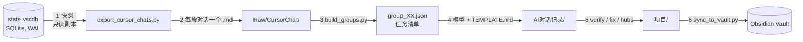

# Cursor → Obsidian 知识库

[](https://www.python.org/)
[](LICENSE)
[](#环境要求)
[](https://obsidian.md/)

把 **Cursor 的历史对话**导出成 Markdown，再提炼成带双链的 **Obsidian 笔记**。纯 Python 标准库，零第三方依赖，Windows / macOS / Linux 通用。

Cursor 把每段对话都存在本地 SQLite 里，却不提供批量导出。这套工具直接读那个数据库——**先复制、只读打开，绝不碰运行中的编辑器**——把对话还原成 Markdown，并搭出三层结构：一层完整原文供溯源，一层提炼笔记供日常查阅，一层项目主页做导航。

## 为什么分两层

| 层 | 目录 | 用途 |
|---|---|---|
| 原文层 | `Raw/CursorChat/` | 完整对话逐字保留（含工具调用轨迹），只做溯源，不常读 |
| 知识层 | `AI对话记录/` | 一篇对话一篇笔记：结论、关键实现、踩坑、待办 |
| 导航层 | `项目/` | 每个项目一篇主页，汇总该项目所有对话的时间线 |

直接把原文倒进 Obsidian 会造成两个后果：一遍遍重试的中间过程、几百条工具调用、空草稿全都进图谱，搜什么都搜不准。但纯提炼又有风险——模型可能漏掉细节，而细节恰恰是以后要复用的。

所以两层并存：每篇笔记的 frontmatter 里带一个 `raw:` 回链，一键跳回原文。**检索靠知识层，溯源靠原文层。**

## 流水线



第 4 步是唯一需要模型的环节——判断「哪些是噪音、哪句是结论、这个报错的根因是什么」无法脚本化。其余五步都是确定性的。

## 目录结构

```
MyVault/
├─ Cursor 对话知识库.md          ← 自动生成的首页，链到所有项目主页
├─ Raw/
│  └─ CursorChat/                ← 第 1 层：原文归档
│     ├─ _index.md               ←   索引表：日期 / 标题 / 项目 / 消息数 / 字符数
│     └─ 2026-09-03 Celery usage in project -594806de.md
├─ AI对话记录/                    ← 第 2 层：提炼笔记，一对话一篇
│  ├─ 2026-09-03 Celery 任务台账与队列治理 -594806de.md
│  └─ …
└─ 项目/                         ← 第 3 层：项目主页
   ├─ wms_be.md                  ←   概览 + 时间线 + 标签分布
   └─ …
```

文件名格式是 `YYYY-MM-DD 主题 -<id8>.md`。8 位十六进制后缀保证「同一天、同标题」的多段对话不会互相覆盖；命名规则刻意避开 `[ ] | # : ? *`，所以 `[[双链]]` 永远不会断。

## 一篇笔记长什么样

```markdown
---
date: 2026-09-03
project: wms_be
type: ai-对话笔记
tags: [cursor-ai, 技术笔记, Celery, Django]
source: cursor
raw: "[[2026-09-03 Celery usage in project -594806de]]"
session_id: 594806de-be39-46c2-a22c-0e0beaf23c43
messages: 13
tool_calls: 61
---

# Celery 在 wms_be 的落地：任务台账 + 队列治理

> [!summary] 核心结论
> …

## 关键内容
## ⚠️ 踩坑与注意事项
## 📌 待办 / 后续
## 🔗 关联
- 原始对话：[[2026-09-03 Celery usage in project -594806de]]
```

## 快速开始

```powershell
git clone git@github.com:PF-UI/cursor-kb.git
cd cursor-kb

python export_cursor_chats.py --stats                            # 1. 先看有多少段对话
python export_cursor_chats.py --out "D:\MyVault\Raw\CursorChat"  # 2. 导出原文层
python _batch\build_groups.py                                    # 3. 切分任务批次

# 4. 把 _batch\group_XX.json 交给你的 AI，把 _batch\TEMPLATE.md 的内容当系统提示，
#    它就会按规范把每段对话写成一篇笔记，落到 AI对话记录\

python _batch\verify.py                                          # 5. 双链闭合体检
python _batch\fix_projects.py                                    #    归并项目名
python _batch\make_hubs.py                                       #    生成项目主页
python _batch\sync_to_vault.py --vault "D:\MyVault"              # 6. 同步进 Vault
```

所有脚本都支持 `--base <知识库目录>`（默认取脚本所在目录），整个文件夹放在哪都能跑。

## 环境要求

- **Python 3.10+**（用到 `X | None` 类型标注），无需 `pip install` 任何东西。
- **Cursor 装过且有对话记录**——那是唯一的数据源。
- **一个 Obsidian vault**，空文件夹也行。

Cursor 数据库位置自动识别：

| 系统 | 路径 |
|---|---|
| Windows | `%APPDATA%\Cursor\User\globalStorage\state.vscdb` |
| macOS | `~/Library/Application Support/Cursor/User/globalStorage/state.vscdb` |
| Linux | `~/.config/Cursor/User/globalStorage/state.vscdb` |

装在非常规位置时用 `--cursor-db "<路径>"` 指定。

## 脚本清单

| 文件 | 作用 | 关键参数 |
|---|---|---|
| `export_cursor_chats.py` | 快照数据库，每段对话写一个 `.md` | `--stats` `--out` `--min-chars` `--clean` `--cursor-db` |
| `_batch/TEMPLATE.md` | 交给模型的写作规范（frontmatter、callout、红线） | — |
| `_batch/build_groups.py` | 按项目贪心分箱，生成任务清单 | `--cap-chars` `--max-batch` |
| `_batch/verify.py` | 校验原文与笔记 1:1 对应、frontmatter 完整 | `--base` |
| `_batch/fix_projects.py` | 归并路径派生的假项目名，改写相关双链 | `--dry-run` |
| `_batch/make_hubs.py` | 生成项目主页（MOC） | `--base` |
| `_batch/sync_to_vault.py` | 按三层结构同步进 Vault，写首页 | `--vault` `--dry-run` |

## 导出原理

Cursor 把对话头信息放在 `composerHeaders`，正文放在通用的 `cursorDiskKV` 表里（`composerData:<id>` 存有序的消息列表，`bubbleId:<对话>:<消息>` 存单条消息）。导出器做了五件事：

1. 把 `state.vscdb` 连同 `-wal`、`-shm` 复制到脚本旁边，以 `mode=ro` 打开，**不锁正在运行的编辑器**；
2. 按 `fullConversationHeadersOnly[]` 走，保证消息顺序和 Cursor 界面里一致；
3. 保留用户与助手文本，工具调用压缩成一行 `> 🛠 名称 · path=… · 状态`——这一步决定了「一万条消息的失控循环」不会变成 20 MB 的垃圾文件；
4. 项目名依次从 `workspaceStorage/*/workspace.json`、`trackedGitRepos`、文件路径里出现最多的那一段推断（老对话经常指向已经删掉的 workspace）；
5. 用 `--min-chars` 过滤空草稿和薄对话。

## 排错

| 现象 | 原因 / 解法 |
|---|---|
| `Cursor database not found` | 这台机器没跑过 Cursor，或路径特殊，用 `--cursor-db` 指定 |
| 导出的对话内容为空 | `state.vscdb` 里有大量空草稿 composer，`--min-chars` 会自动滤掉 |
| 控制台中文乱码 | 先 `chcp 65001`，并设 `$env:PYTHONIOENCODING='utf-8'` |
| `verify.py` 报 missing | 某篇笔记还没写，或 `raw:` 双链里的 8 位 id 抄错了 |
| Obsidian 里双链点不开 | 文件名含 `[ ] \| # : ? *`，本工具的命名已规避 |
| Windows 上 HTTPS 报 `schannel` 错误 | `git config --global http.sslBackend openssl`（与本项目无关的 Git 环境问题） |

## English summary

A toolkit that exports **Cursor's local chat history** into Markdown and distills it into a linked **Obsidian** knowledge base. Pure Python standard library, zero dependencies, works on Windows / macOS / Linux.

Cursor stores every conversation in a local SQLite database (`state.vscdb`) and offers no bulk export. This project reads it on a **read-only copy**, reconstructs each conversation, and builds three layers: a verbatim **raw archive** for traceability, **AI-distilled notes** for daily reading, and **project hubs** for navigation. Every note carries a `raw:` backlink to its source transcript.

```bash
python export_cursor_chats.py --stats                            # inspect
python export_cursor_chats.py --out "D:/MyVault/Raw/CursorChat"  # export raw layer
python _batch/build_groups.py                                    # slice into batches
#   hand each _batch/group_XX.json + _batch/TEMPLATE.md to an LLM -> notes
python _batch/verify.py && python _batch/make_hubs.py            # check + build hubs
python _batch/sync_to_vault.py --vault "D:/MyVault"              # sync
```

The distillation step is the only one that needs a model; everything else is deterministic. See the Chinese sections above for the database schema details, per-script options and troubleshooting.

## License

[MIT](LICENSE) © 2026 PF-UI
