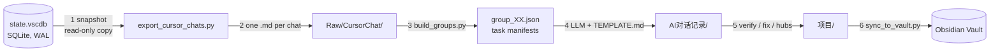

# Cursor → Obsidian Knowledge Base

[](https://www.python.org/)
[](LICENSE)
[](#requirements)
[](https://obsidian.md/)

Turn **Cursor's local chat history** into a searchable **Obsidian knowledge base** — one Markdown file per conversation, plus AI-distilled notes with YAML frontmatter, callouts and `[[wikilinks]]`.

Cursor keeps every conversation in a local SQLite database and offers no bulk export. This toolkit reads that database directly (on a copy, read-only), reconstructs each conversation, and builds a two-layer vault: a complete **raw archive** for traceability, and a **distilled layer** you actually read.

Works on Windows, macOS and Linux. Pure Python standard library — nothing to `pip install`.

## Why two layers

| Layer | Folder | Purpose |
|---|---|---|
| Raw archive | `Raw/CursorChat/` | Full transcript, verbatim. For tracing a decision back to its source. |
| Knowledge layer | `AI对话记录/` | One note per conversation: summary, key implementation, pitfalls, TODOs. |
| Navigation | `项目/` | One hub per project: timeline of every conversation in that project. |

Dumping raw transcripts straight into Obsidian pollutes the graph with retry loops, tool-call noise and empty chatter. Keeping the raw text one click away — every note carries a `raw:` backlink in its frontmatter — preserves traceability without the clutter.

## Pipeline



Step 4 is the only step that needs a model — deciding what is noise, what is a conclusion, and what caused an error cannot be scripted. Everything else is deterministic.

## Vault layout

```
MyVault/
├─ Cursor 对话知识库.md          ← generated home page, links every hub
├─ Raw/
│  └─ CursorChat/                ← layer 1: verbatim archive
│     ├─ _index.md               ←   table: date / title / project / messages / chars
│     └─ 2026-09-03 Celery usage in project -594806de.md
├─ AI对话记录/                    ← layer 2: distilled notes, one per conversation
│  ├─ 2026-09-03 Celery 任务台账与队列治理 -594806de.md
│  └─ …
└─ 项目/                         ← layer 3: project hubs
   ├─ wms_be.md                  ←   overview + timeline + tag distribution
   └─ …
```

Filenames are `YYYY-MM-DD <topic> -<id8>.md`. The 8-hex-char suffix keeps names unique when several chats on the same day share a title, and the format deliberately avoids `[ ] | # : ? *` so `[[wikilinks]]` never break.

A distilled note:

```markdown
---
date: 2026-09-03
project: wms_be
type: ai-对话笔记
tags: [cursor-ai, 技术笔记, Celery, Django]
source: cursor
raw: "[[2026-09-03 Celery usage in project -594806de]]"
session_id: 594806de-be39-46c2-a22c-0e0beaf23c43
messages: 13
tool_calls: 61
---

# Celery 在 wms_be 的落地：任务台账 + 队列治理

> [!summary] 核心结论
> …

## 关键内容
## ⚠️ 踩坑与注意事项
## 📌 待办 / 后续
## 🔗 关联
- 原始对话：[[2026-09-03 Celery usage in project -594806de]]
```

## Quick start

```bash
git clone git@github.com:PF-UI/cursor-kb.git
cd cursor-kb

python export_cursor_chats.py --stats                            # 1. how many chats do I have?
python export_cursor_chats.py --out "D:/MyVault/Raw/CursorChat"  # 2. export the raw layer
python _batch/build_groups.py                                    # 3. slice into task batches

# 4. hand each _batch/group_XX.json to your AI of choice, with _batch/TEMPLATE.md
#    as the writing spec — it writes one note per chat into AI对话记录/

python _batch/verify.py                                          # 5. link-integrity check
python _batch/fix_projects.py                                    #    normalise project names
python _batch/make_hubs.py                                       #    build project hubs
python _batch/sync_to_vault.py --vault "D:/MyVault"              # 6. copy into the vault
```

Every script accepts `--base <kb-dir>` (defaults to its own directory), so the folder can live anywhere.

## Requirements

- **Python 3.10+** (uses `X | None` annotations). No third-party packages.
- **Cursor installed with existing chat history** — that database is the only data source.
- An **Obsidian vault** (an empty folder is fine).

Cursor's database is auto-detected:

| OS | Path |
|---|---|
| Windows | `%APPDATA%\Cursor\User\globalStorage\state.vscdb` |
| macOS | `~/Library/Application Support/Cursor/User/globalStorage/state.vscdb` |
| Linux | `~/.config/Cursor/User/globalStorage/state.vscdb` |

Override with `--cursor-db "<path>"` when Cursor lives elsewhere.

## Scripts

| File | Role | Key options |
|---|---|---|
| `export_cursor_chats.py` | Snapshot the DB, write one `.md` per conversation | `--stats`, `--out`, `--min-chars`, `--clean`, `--cursor-db` |
| `_batch/TEMPLATE.md` | Writing spec handed to the model (frontmatter, callouts, red lines) | — |
| `_batch/build_groups.py` | Greedy bin-packing into task manifests | `--cap-chars`, `--max-batch` |
| `_batch/verify.py` | Assert a 1:1 mapping between raw files and notes, check frontmatter | `--base` |
| `_batch/fix_projects.py` | Merge path-derived fake project names, rewrite links | `--dry-run` |
| `_batch/make_hubs.py` | Generate project hub notes | `--base` |
| `_batch/sync_to_vault.py` | Copy layers into the vault, write the home page | `--vault`, `--dry-run` |

## How the export works

Cursor keeps conversation headers in `composerHeaders` and everything else in a generic `cursorDiskKV` table (`composerData:<id>` holds the ordered bubble list, `bubbleId:<chat>:<msg>` holds each message). The exporter:

1. copies `state.vscdb` + `-wal` + `-shm` next to the script and opens it `mode=ro`, so the running editor is never locked;
2. walks `fullConversationHeadersOnly[]` to preserve true message order;
3. keeps user and assistant text, collapsing every tool call into a single `> 🛠 name · path=… · status` line — this is what keeps a 10,000-message runaway agent loop from becoming a 20 MB file;
4. resolves the project name from `workspaceStorage/*/workspace.json`, then `trackedGitRepos`, then the most common path segment of the touched files (old chats often point at workspaces that no longer exist);
5. skips drafts and empty chats via `--min-chars`.

## Troubleshooting

| Symptom | Cause / fix |
|---|---|
| `Cursor database not found` | Cursor never ran here; pass `--cursor-db` |
| Exported chats look empty | `state.vscdb` holds many empty draft composers — `--min-chars` filters them |
| Mojibake in the console | `chcp 65001` (or `[Console]::OutputEncoding=[Text.Encoding]::UTF8`) plus `PYTHONIOENCODING=utf-8` |
| `verify.py` reports missing notes | a note is unwritten, or the 8-char id in its `raw:` link is wrong |
| Wikilinks don't resolve | filenames contain `[ ] \| # : ? *` — this toolkit's naming avoids them |

## 中文说明

把 Cursor 的历史对话导出成 Markdown，再提炼成带双链的 Obsidian 笔记。纯 Python 标准库，零第三方依赖。

**核心取舍**：原文层与知识层分离。原文完整保留（含工具调用轨迹）只做溯源；知识层只留结论、关键实现、踩坑和待办，避免把反复试错和闲聊灌进笔记图谱。

```powershell
python export_cursor_chats.py --stats
python export_cursor_chats.py --out "D:\MyVault\Raw\CursorChat"
python _batch\build_groups.py
# 把 _batch\group_XX.json 交给 AI，按 _batch\TEMPLATE.md 写笔记到 AI对话记录\
python _batch\verify.py
python _batch\fix_projects.py
python _batch\make_hubs.py
python _batch\sync_to_vault.py --vault "D:\MyVault"
```

**关键参数**：`--min-chars 200` 过滤空草稿；`--clean` 导出后删除 1 GB 临时快照；`--vault` 也可用环境变量 `OBSIDIAN_VAULT`；`fix_projects.py` 与 `sync_to_vault.py` 支持 `--dry-run` 先演练。

第 4 步是唯一无法脚本化的环节——判断“哪些是噪音、哪句是结论、这个报错的根因是什么”必须靠模型。

## License

[MIT](LICENSE) © 2026 PF-UI
